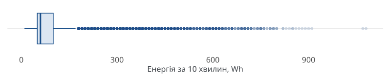
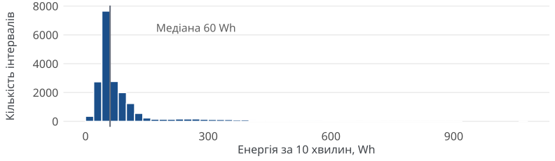
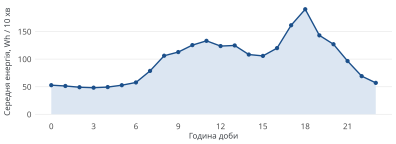
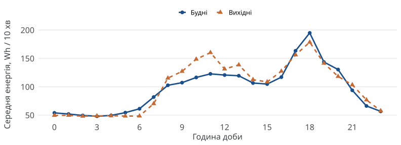
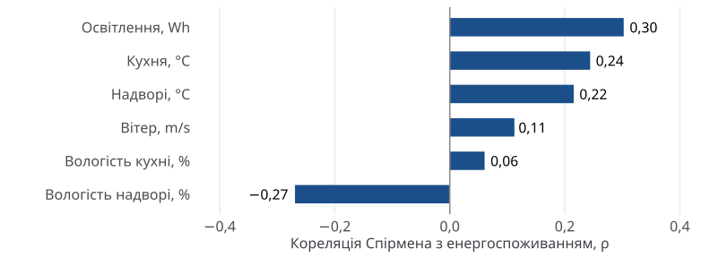
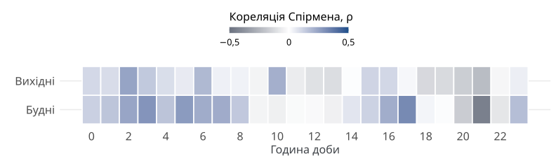

## Енергоспоживання одного будинку {.cover}

Розвідувальний аналіз даних · лабораторна №2

Ковальчук Ярослав АтаВДвR-11

Appliances Energy Prediction · Бельгія, 2016

::: {.notes}
Представити тему та мету: з’ясувати, як розподіляється споживання й з якими факторами воно пов’язане. Аналіз описовий; регресійні моделі не навчаються. Орієнтовно 25 секунд.
:::

## Дані та запитання

<b>19 735</b>вимірювань

<b>10 хв</b>між записами

<b>1 будинок</b>січень — травень 2016

Ціль — <strong>енергія побутових приладів, Wh за інтервал</strong>

<ol class="questions"><li>Які типові значення та піки?</li><li>Як змінюється споживання протягом доби?</li><li>Чим відрізняються будні й вихідні?</li><li>Які зв’язки з температурою, вологістю та світлом?</li><li>Що змінюється при поділі за годиною й типом дня?</li></ol>

::: {.notes}
Дані реальні: датчики одного енергоефективного будинку в Бельгії та погода найближчої метеостанції. Період 11 січня — 27 травня 2016 року, 29 початкових стовпців. Енергія є кількісною ціллю, хоча записана з округленням. Вона не є потужністю. Джерело: https://doi.org/10.24432/C5VC8G. Орієнтовно 45 секунд.
:::

## Піки збережено після перевірки

<b>0</b>пропущених комірок

<b>0</b>дублікатів часу

<b>10,8%</b>інтервалів вище межі IQR

Вилучення піків знизило б середнє з <strong>97,7 до 67,2 Wh</strong>

Правило 1,5 IQR (міжквартильного розмаху) не є доказом помилки датчика.

::: {.notes}
Перевірено типи, пропуски, дублікати, регулярність кроку й фізичні межі. Усі часові кроки — 600 секунд. Межа 1,5 IQR становить 175 Wh; вище неї 2138 інтервалів. Такі піки можуть бути реальними режимами роботи приладів, тому не вилучались. Імпутація також не потрібна. Орієнтовно 40 секунд.
:::

## Середнє вище типового значення

<b>60 Wh</b>медіана

<b>97,7 Wh</b>середнє

<b>50–100 Wh</b>центральні 50% значень

Правий хвіст підвищує середнє; для типового інтервалу доречна медіана.

::: {.notes}
На гістограмі більшість спостережень розташована біля невеликих значень, але хвіст доходить до 1080 Wh. Медіана 60 Wh означає, що половина інтервалів має не більше цього значення. Не варто робити висновок про нормальний розподіл або замінювати піки лише через асиметрію. Орієнтовно 35 секунд.
:::

## Вечірній пік — близько 18:00

<strong>190,4 Wh</strong> о 18:00 проти <strong>48,2 Wh</strong> о 03:00 — приблизно у 3,9 раза більше

::: {.notes}
Кожна точка — середнє всіх десятихвилинних вимірювань відповідної години, а не сума за годину. Нічний рівень нижчий, зранку споживання зростає; найвищий середній рівень о 18-й годині. Профіль узгоджується з можливою активністю мешканців, але даних про присутність немає. Орієнтовно 40 секунд.
:::

## Вихідні відрізняються за годинами

Загальні середні близькі: <strong>96,6 Wh</strong> у будні та <strong>100,6 Wh</strong> у вихідні

::: {.notes}
Групи містять різну кількість рядків: 14263 будніх і 5472 вихідних інтервалів. Тому порівнюються середні, а не суми. Загальна різниця становить приблизно 4 Wh, або 4,1%, але лінії показують, що вона неоднакова за годинами. Не називаємо цю різницю статистично значущою: тести не виконувались. Орієнтовно 40 секунд.
:::

## Зв’язки з окремими факторами обмежені

Кореляція Спірмена описує монотонний зв’язок; вона не доводить причинності.

::: {.notes}
Показано кореляції Спірмена для шести змістовних факторів із цільовою змінною. Спірмен оцінює зв’язок рангів; коефіцієнти Пірсона наведено в ноутбуці. Наприклад, для освітлення Пірсон дорівнює 0,20, а Спірмен 0,30. Повна матриця в ноутбуці також показує взаємозв’язок температур кімнат. Випадкові rv1 і rv2 не аналізуються. Слабка кореляція не виключає складної залежності. Орієнтовно 45 секунд.
:::

## Час змінює картину зв’язків

Зовнішня температура × споживання

<b>0,22</b>ρ для всієї вибірки

<b>−0,44 … 0,32</b>ρ у часових підгрупах

Загальна кореляція приховує відмінності між годинами й типами дня.

::: {.notes}
Кожна клітинка — кореляція температури та споживання в одній годині й одному типі дня. Зв’язок змінює силу й напрям: від −0,44 до 0,32. Це не часткова кореляція та не доказ причинності: сезонність і приховані фактори залишаються. Автокореляція сусідніх інтервалів 0,75 означає, що рядки не є незалежними експериментами. Орієнтовно 50 секунд.
:::

## Висновки та межі дослідження

<strong>Типове споживання — 60 Wh.</strong> Високі піки підвищують середнє до 97,7 Wh.

<strong>Час доби пов’язаний зі споживанням.</strong> Найвище погодинне середнє — близько 18:00.

<strong>Потрібні порівняння в підгрупах.</strong> Зв’язки з погодою неоднакові за годинами.

Один будинок · частина року · немає даних про присутність мешканців · залежні вимірювання

Далі: довший період і кілька будинків; для регресії — перевірка на пізніших датах.

::: {.notes}
Підсумувати відповіді на п’ять запитань. Розподіл асиметричний, піки збережено; є вечірній пік; загальна різниця буднів і вихідних невелика, але профілі відрізняються; зв’язки з окремими факторами обмежені й залежать від підгруп. Не узагальнюємо результат на всі будинки й не заявляємо причинного впливу. Джерела: DOI 10.24432/C5VC8G та 10.1016/j.enbuild.2017.01.083. Орієнтовно 40 секунд.
:::

