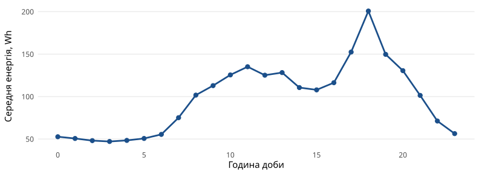
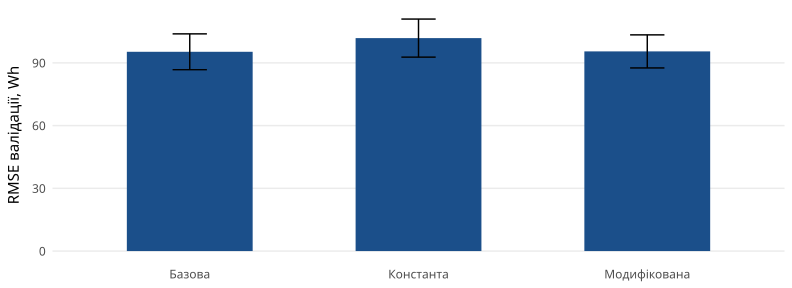
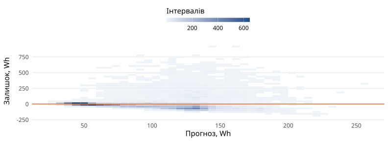
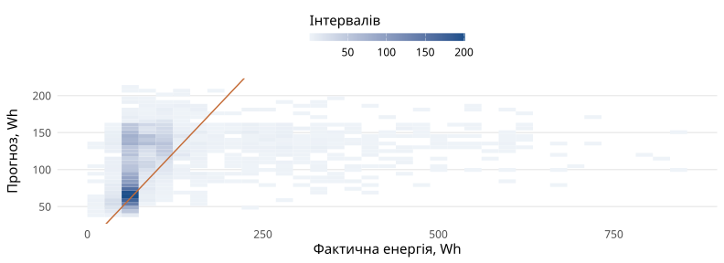

```{r}
s <- read.csv("outputs/tables/test_scores.csv")
cvs <- read.csv("outputs/tables/cv_summary.csv")
hyp <- read.csv("outputs/tables/hypotheses.csv")
f <- function(x) formatC(x,format="f",digits=2,decimal.mark=",")
```

## Прогноз енергоспоживання {.cover}

<p class="subtitle">Лабораторна №3. Основи регресійного моделювання</p>
<p class="author">Ковальчук Ярослав<br>АтаВДвR-11</p>

::: {.notes}
Мета: спрогнозувати наступні десять хвилин для того самого будинку. Це продовження лабораторної №2, із тією самою ціллю у Wh.
:::

## Питання та дві гіпотези

Чи покращує регресія прогноз наступного інтервалу порівняно із середнім?

1. Попереднє освітлення позитивно пов’язане з наступною енергією приладів.
2. О 18:00 рівень вищий, ніж о 03:00, за однакових інших ознак.

<p class="small">Candanedo та ін. (2017): сенсорні фактори.<br>Richardson та ін. (2010): добові профілі активності.</p>
<p class="takeaway">Гіпотези розвідувальні: попередній EDA вже охопив увесь набір.</p>

::: {.notes}
Джерела: DOI 10.1016/j.enbuild.2017.01.083 та 10.1016/j.enbuild.2010.05.023. Перша праця обґрунтовує сенсори, друга — календар як непряму характеристику активності. Власних даних про присутність мешканців немає.
:::

## Добовий профіль визначив часові ознаки

<div class="chart tall">



</div>

<p class="takeaway">Графік побудовано лише на навчальному періоді. Піки збережено.</p>

## Майбутній період залишено для тесту

```{r}
knitr::kable(read.csv("outputs/tables/split.csv"),col.names=c("Частина","Початок","Кінець","Рядків"))
```

- Чотири зростаючі часові вікна в навчальній частині.
- Ознаки сенсорів беруться з попереднього завершеного інтервалу.
- Основна метрика — RMSE, додаткова — MAE, обидві у Wh.

<p class="takeaway">Тест раніше переглядався в EDA №2. Його незалежність обмежена.</p>

::: {.notes}
Прогноз передбачає доступність завершеного сенсорного запису. Погодні ознаки метеостанції не використовуємо через інтерполяцію. Підбір моделі виконуємо до тесту; випадковий поділ для цього часового ряду не застосовуємо.
:::

## Модифікація не дала переваги у валідації

<div class="chart tall">



</div>

<p class="takeaway">Обрано базову регресію. Вертикальні відрізки показують SD між блоками.</p>

::: {.notes}
constant — навчальне середнє. base — освітлення, температура, вологість кухні, перша гармоніка і вихідний. modified додає другу гармоніку і взаємодію часу з вихідним. Це одна обґрунтована спроба покращення. SD не є довірчим інтервалом.
:::

## Обидві оцінки узгоджуються з гіпотезами

```{r}
knitr::kable(hyp,col.names=c("Контраст","Оцінка, Wh","Нижня 95%","Верхня 95%"),digits=2)
```

Попереднє освітлення: на 1 Wh більше, за однакових інших ознак.

Часовий контраст: 18:00 проти 03:00 за однакових сенсорних значень.

<p class="takeaway">Наближені інтервали Newey–West враховують часову залежність до доби. Це асоціації.</p>

::: {.notes}
Інтервали не включають нуль і додатні. HAC використовує лаг 144 десятихвилинних записи. Вибір лага і можлива сезонність обмежують інтерпретацію. Гіпотези залишаються розвідувальними.
:::

## Лінійна модель недооцінює піки

<div class="chart tall">



</div>

<p class="takeaway">Великі позитивні залишки відповідають недооціненому споживанню.</p>

::: {.notes}
У звіті додатково є Q–Q графік, автокореляція залишків, відстань Кука та важіль. Позначені впливові записи не вилучали. Модель середнього профілю не описує всі раптові ввімкнення.
:::

## На тесті виграш RMSE становить `r formatC(100*(1-s$RMSE[2]/s$RMSE[1]),format="f",digits=1,decimal.mark=",")`%

```{r}
s$model <- c("Константа","Базова")
knitr::kable(s,col.names=c("Модель","RMSE, Wh","MAE, Wh"),digits=2)
```

<div class="chart" style="height:320px">



</div>

<p class="takeaway">Вибір моделі зафіксовано до тесту. Найбільші промахи — на піках.</p>

## Висновки та межі прогнозу

- Базова регресія покращила RMSE константного прогнозу, але виграш невеликий.
- Додатні оцінки освітлення та вечірнього контрасту підтримують розвідувальні гіпотези.
- Один будинок, частина року й попередній перегляд тесту обмежують узагальнення.

<p class="takeaway">Наступний крок: перевірити незмінену модель на новому місяці вимірювань.</p>

::: {.notes}
Дослідницьке питання отримало кількісну відповідь: точність порівнюємо з константою, зберігаючи одиниці Wh. Причинного впливу не доводимо. Відтворення, формули, повні таблиці та бібліографія наведені у звіті.
:::
